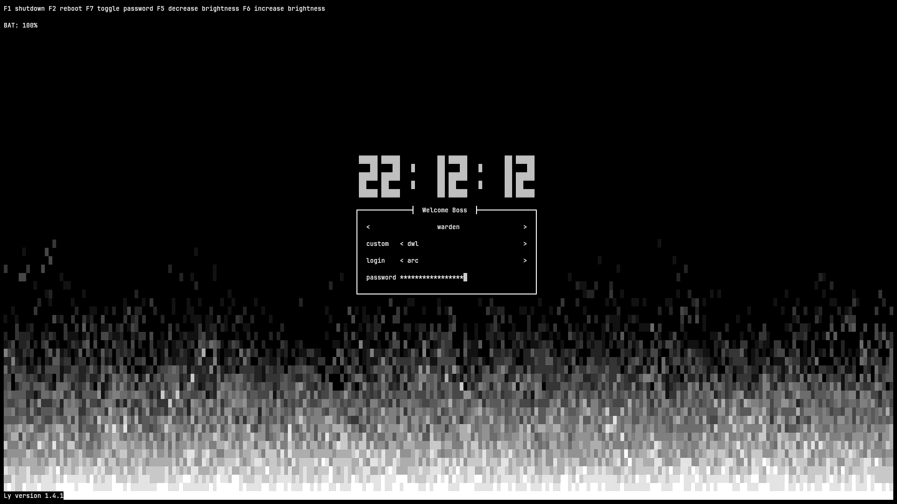
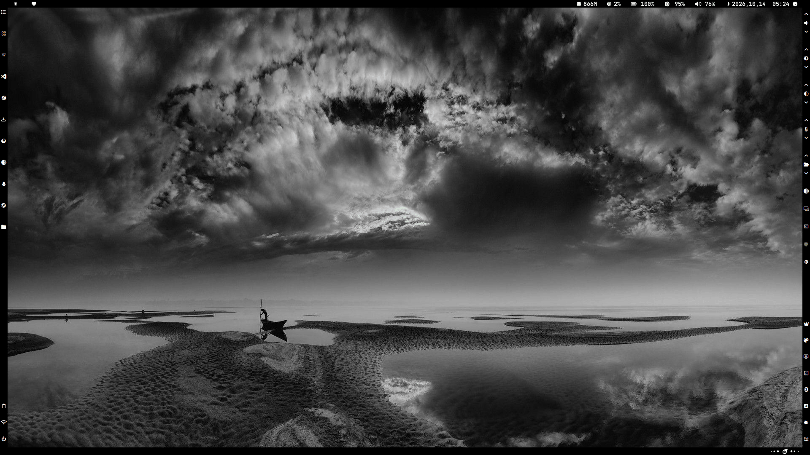
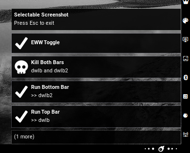
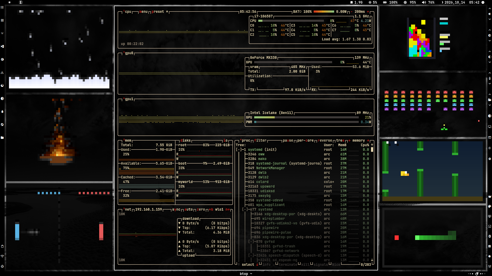
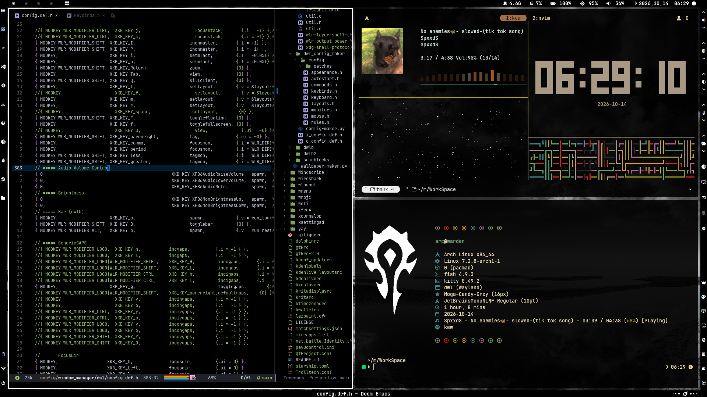
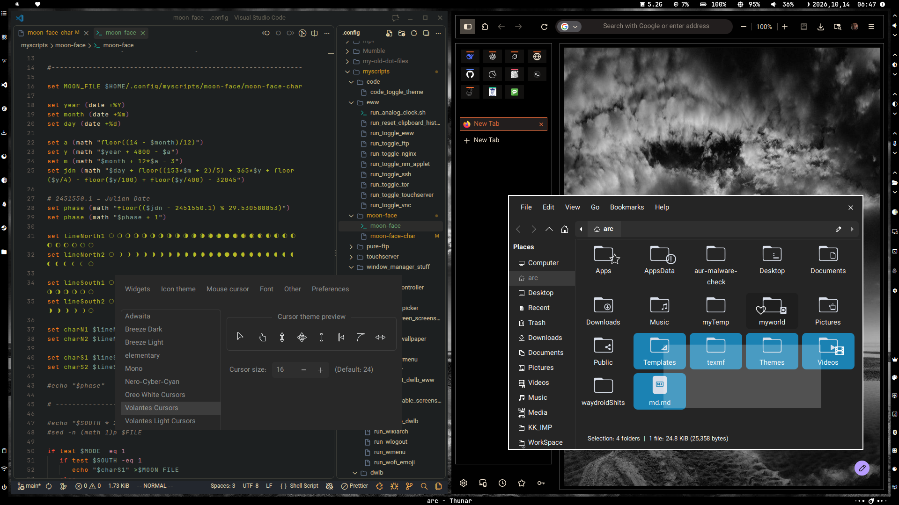

# dotfiles

## Contents:

- [Screenshots](#Screenshots)
- [Themes](#Themes)
- [Keybinds](#Keybinds)
## Screenshots

<table>
  <tr>
    <td align="center" colspan="2">
      
       <b>Display Manager, ly</b>
    </td>
  </tr>
  <tr>
    <td align="center">
      
       <b>Grub, Space Isolation Mono, 1</b>
    </td>
    <td align="center">
      
       <b>Grub, Space Isolation Mono, 2</b>
    </td>
  </tr>
  <tr>
    <td align="center"> <b>dwl</b></td>
    <td align="center"> <b>Mako Notifications</b></td>
  </tr>
  <tr>
    <td align="center"> <b>Terminal Apps, 1</b></td>
    <td align="center"> <b>Terminal Apps, 2</b></td>
  </tr>
  <tr>
    <td align="center" colspan="2">
      
       <b>GUI Apps</b>
    </td>
  </tr>

</table>

## Themes:

- Theme: [MonoThemeDark](https://github.com/witalihirsch/Mono-gtk-theme/) , [Download](https://github.com/witalihirsch/Mono-gtk-theme/releases/) , [Installation](https://github.com/witalihirsch/Mono-gtk-theme#installing)

- Icons: [Yet-Another-Monochrome-Icon-Set(YAMIS)](https://github.com/googIyEYES/YAMIS) , [Download and Installation](https://github.com/googIyEYES/YAMIS#installation)

- Cursor: [volantes-cursors](https://github.com/varlesh/volantes-cursors) , [Download](https://www.opendesktop.org/p/1356095/) , Installation (dwl config file. `lxappearance`. `nwg-look`)

- Fonts: [Vazirmatn](https://github.com/rastikerdar/vazirmatn) , [JetBrainsMono Nerd Font](https://github.com/ryanoasis/nerd-fonts)

## Keybinds

>> <kbd> ❖</kbd> == Super Key

| **Keybinds**          | **Description** |
| ----------------- | ----------- |
| 📍 **Apps**    | ----------------- |
| <kbd> ❖</kbd> + <kbd>Return</kbd> |   terminal (kitty) |
| <kbd> ❖</kbd> + <kbd>F1</kbd> |  obsidian |
| <kbd> ❖</kbd> + <kbd>F2</kbd> |  firefox |
| <kbd> ❖</kbd> + <kbd>⇧ Shift</kbd>  + <kbd>F2</kbd> |  tor browser |
| <kbd> ❖</kbd> + <kbd>⎇ Alt</kbd>  + <kbd>F2</kbd> |  qutebrowser |
| <kbd> ❖</kbd> + <kbd>F3</kbd> |  thunar (file manager) |
| <kbd> ❖</kbd> + <kbd>⇧ Shift</kbd>  + <kbd>F3</kbd> |  spf (alt file manager) |
| <kbd> ❖</kbd> + <kbd>⎇ Alt</kbd>  + <kbd>F3</kbd> |  ranger (alt file manager)|
| <kbd> ❖</kbd> + <kbd>F4</kbd> |  vscode |
| <kbd> ❖</kbd> + <kbd>⎇ Alt</kbd>  + <kbd>F4</kbd> |  vscode change theme |
| <kbd> ❖</kbd> + <kbd>⇧ Shift</kbd>  + <kbd>F4</kbd> |  emacs |
| <kbd> ❖</kbd> + <kbd>⇧ Shift</kbd>  + <kbd>Escape</kbd> |  btop |
| <kbd> ❖</kbd> + <kbd>⌃ Ctrl</kbd>  + <kbd>Escape</kbd> |  nvtop |
| 📍 **Extra Apps**    | ----------------- |
| <kbd> ❖</kbd> + <kbd>s</kbd> |  selectable screenshot |
| <kbd> ❖</kbd> + <kbd>⇧ Shift</kbd>  + <kbd>S</kbd> |  fullscreen screenshot |
| <kbd> ❖</kbd> + <kbd>c</kbd> |  color picker |
| 📍 **Menus**    | ----------------- |
| <kbd> ❖</kbd> + <kbd>d</kbd> |  app launcher (wmenu) |
| <kbd> ❖</kbd> + <kbd>⌃ Ctrl</kbd>  + <kbd>d</kbd> |  alt app launcher (rofi) |
| <kbd> ❖</kbd> + <kbd>0</kbd> |  power menu (wmenu)|
| <kbd> ❖</kbd> + <kbd>⌃ Ctrl</kbd>  + <kbd>0</kbd> |  alt power menu (wlogout) |
| <kbd> ❖</kbd> + <kbd>n</kbd> |  emoji picker |
| <kbd> ❖</kbd> + <kbd>v</kbd> |  clipboard |
| <kbd> ❖</kbd> + <kbd>⎇ Alt</kbd>  + <kbd>v</kbd> |  reset clipboard history |
| <kbd> ❖</kbd> + <kbd>w</kbd> |  arch wiki search |
| 📍 **Tag Controls**    | ----------------- |
| <kbd> ❖</kbd> + <kbd>1 ~ 9</kbd> |  view tag 1 ~ 9 |
| <kbd> ❖</kbd> + <kbd>⌃ Ctrl</kbd>  + <kbd>1 ~ 9</kbd> |  add view tag 1 ~ 9 |
| <kbd> ❖</kbd> + <kbd>⌃ Ctrl</kbd>  + <kbd>H / Left</kbd> |  previous tag with window |
| <kbd> ❖</kbd> + <kbd>⌃ Ctrl</kbd>  + <kbd>L / Right</kbd> |  next tag with window |
| <kbd> ❖</kbd> + <kbd>Tab</kbd> |  view (previous tag) |
| 📍 **Window Controls**    | ----------------- |
| <kbd> ❖</kbd> + <kbd>⇧ Shift</kbd>  + <kbd>1` ~ `9</kbd> |  send focused win to tag 1 ~ 9 |
| <kbd> ❖</kbd> + <kbd>e</kbd> |  list all windows (wmenu) |
| <kbd> ❖</kbd> + <kbd>⇧ Shift</kbd>  + <kbd>Q</kbd> |  kill focused window |
| <kbd> ❖</kbd> + <kbd>⇧ Shift</kbd>  + <kbd>Return</kbd> |  zoom (swap master) |
| <kbd> ❖</kbd> + <kbd>f</kbd> |  toggle fullscreen |
| <kbd> ❖</kbd> + <kbd>h / Left</kbd> |  focus left |
| <kbd> ❖</kbd> + <kbd>l / Right</kbd> |  focus right |
| <kbd> ❖</kbd> + <kbd>k / Up</kbd> |  focus up |
| <kbd> ❖</kbd> + <kbd>j / Down</kbd> |  focus down |
| <kbd> ❖</kbd> + <kbd>⇧ Shift</kbd>  + <kbd>H / Left</kbd> |  move window left |
| <kbd> ❖</kbd> + <kbd>⇧ Shift</kbd>  + <kbd>L / Right</kbd> |  move window right |
| <kbd> ❖</kbd> + <kbd>⇧ Shift</kbd>  + <kbd>K / Up</kbd> |  move window up |
| <kbd> ❖</kbd> + <kbd>⇧ Shift</kbd>  + <kbd>J / Down</kbd> |  move window down |
| <kbd> ❖</kbd> + <kbd>,</kbd> |  focus monitor left |
| <kbd> ❖</kbd> + <kbd>.</kbd> |  focus monitor right |
| <kbd> ❖</kbd> + <kbd>⇧ Shift</kbd>  + <kbd>,</kbd> (`<`) | move to monitor left |
| <kbd> ❖</kbd> + <kbd>⇧ Shift</kbd>  + <kbd>.</kbd> (`>`) | move to monitor right |
| 📍 **Layouts**    | ----------------- |
| <kbd> ❖</kbd> + <kbd>⇧ Shift</kbd>  + <kbd>E</kbd> |  list leyouts (wmenu) |
| <kbd> ❖</kbd> + <kbd>⇧ Shift</kbd>  + <kbd>R</kbd> |  next layout |
| <kbd> ❖</kbd> + <kbd>⇧ Shift</kbd>  + <kbd>F</kbd> |  toggle floating |
| <kbd> ❖</kbd> + <kbd>t</kbd> |  tile layout |
| <kbd> ❖</kbd> + <kbd>m</kbd> |  monocle layout (single window)|
| <kbd> ❖</kbd> + <kbd>r</kbd> |  dwindle layout (fibonacci) |
| <kbd> ❖</kbd> + <kbd>⇧ Shift</kbd>  + <kbd>C</kbd> |  centered master layout |
| <kbd> ❖</kbd> + <kbd>i</kbd> |  decrease master size |
| <kbd> ❖</kbd> + <kbd>p</kbd> |  increase master size |
| <kbd> ❖</kbd> + <kbd>⇧ Shift</kbd>  + <kbd>I</kbd> |  increase master numbers |
| <kbd> ❖</kbd> + <kbd>⇧ Shift</kbd>  + <kbd>P</kbd> |  decrease master numbers |
| 📍 **Bars & Widgets**    | ----------------- |
| <kbd> ❖</kbd> + <kbd>⇧ Shift</kbd>  + <kbd>W</kbd> |  toggle eww (Widgets) |
| <kbd> ❖</kbd> + <kbd>b</kbd> |  toggle dwlb (KILL)|
| <kbd> ❖</kbd> + <kbd>⇧ Shift</kbd>  + <kbd>B</kbd> |  toggle bar (just hide)|
| <kbd> ❖</kbd> + <kbd>⎇ Alt</kbd>  + <kbd>b</kbd> |  restart dwlb/eww |
| <kbd> ❖</kbd> + <kbd>g</kbd> |  toggle gaps |

